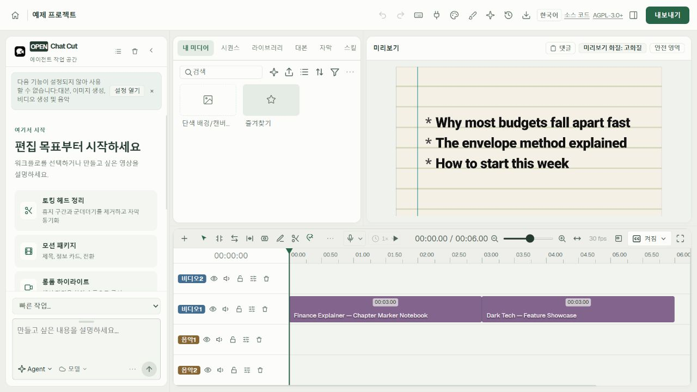
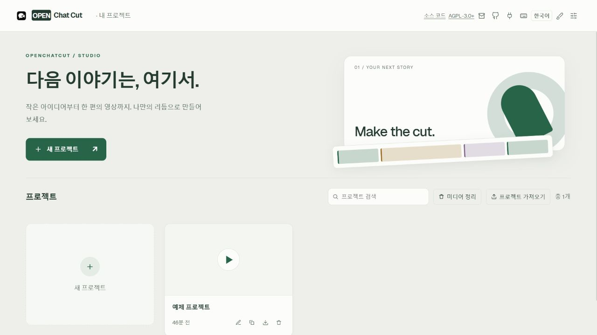
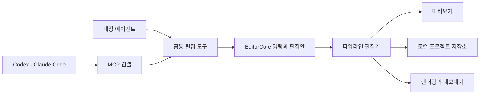

<p align="center">
  
</p>

<h1 align="center">OpenChatCut</h1>

<p align="center">
  <strong>한국어</strong> · <a href="README_ZH.md">简体中文</a>
</p>

<p align="center">
  <strong>대화형 에이전트와 함께 편집하는 로컬 중심 오픈소스 AI 영상 편집기</strong>
</p>

<p align="center">
  Codex, Claude Code, 내장 에이전트로 실제 영상 프로젝트를 읽고 편집하고 내보내세요.
  모든 결과는 타임라인에서 계속 수정할 수 있습니다.
</p>

<!-- 2026-10-23 수정: 한국어 문서 및 커뮤니티 포크의 배포 경로 적용. -->
<p align="center">
  한국어·밝은 테마 기본 커뮤니티 포크 · <a href="MODIFICATIONS.md">수정 내역과 소스 제공 안내</a><br />
  <a href="https://github.com/dev-yunseong/open-chat-cut/releases/latest">설치 파일 다운로드</a> ·
  <a href="https://github.com/0xsline/OpenChatCut">원본 프로젝트</a> ·
  <a href="https://openchatcut.com">원본 프로젝트 웹사이트</a>
</p>

<p align="center">
  <a href="#소개">소개</a> ·
  <a href="#화면-둘러보기">화면 둘러보기</a> ·
  <a href="#빠른-시작">빠른 시작</a> ·
  <a href="#에이전트와-mcp-연결">에이전트 / MCP</a> ·
  <a href="#커뮤니티">커뮤니티</a> ·
  <a href="#원본-프로젝트-후원">후원</a> ·
  <a href="#변경-이력">변경 이력</a> ·
  <a href="#기여하기">기여하기</a>
</p>

<p align="center">
  <a href="https://github.com/dev-yunseong/open-chat-cut"></a>
  <a href="https://discord.gg/bSGUAeWYkh"></a>
  
  
  
  
  
  
  
  <a href="https://atomgit.com/Oxsline/openchatcut"></a>
</p>

<p align="center">
  <a href="https://linux.do"></a>
</p>

<p align="center">
  <a href="https://www.producthunt.com/products/openchatcut?embed=true&amp;utm_source=badge-featured&amp;utm_medium=badge&amp;utm_campaign=badge-openchatcut" target="_blank" rel="noopener noreferrer"></a>
</p>



하나의 프로젝트에서 에이전트, 미디어, 미리보기, 모션 그래픽, 전환, 효과, 멀티트랙 오디오를 함께 다룹니다. 위 화면은 예제 프로젝트의 정적 웹 미리보기이며, 백엔드가 연결되지 않아 연결 오류 문구가 표시됩니다.

## 소개

OpenChatCut은 **대화형 에이전트와 전문적인 타임라인 편집을 한 작업 공간에서 제공하는 오픈소스 ChatCut 대안**입니다. AGPL로 배포되는 독립 프로젝트이며 상용 ChatCut 제품과 제휴 관계가 없습니다.

**OpenChatCut = 로컬 영상 프로젝트 + 멀티트랙 타임라인 + AI 에이전트 + MCP + 영상 내보내기**

편집 결과는 실제 트랙, 클립, 전환, 자막, 효과, 미디어로 프로젝트에 저장됩니다. 직접 수정하거나 실행 취소·다시 실행을 할 수 있고, 버전을 저장하거나 다른 에이전트에 작업을 이어 맡길 수도 있습니다.

이 포크는 한국어와 밝은 Studio 테마를 기본으로 제공합니다. 원본 프로젝트의 저작권과 라이선스를 유지하며, 수정 사항은 [MODIFICATIONS.md](MODIFICATIONS.md)에 기록합니다.

- 🤖 **에이전트 편집**: 내장 에이전트와 외부 MCP 에이전트가 같은 편집 도구를 사용합니다.
- 🎞️ **실제 타임라인**: 여러 영상·오디오 트랙, 전환, 효과, LUT, 확대·축소, 키프레임을 지원합니다.
- 📝 **대본 기반 편집**: 단어 단위 전사, 텍스트로 구간 자르기, 쉼 처리, 화자 구분, 연결된 자막을 제공합니다.
- ✨ **생성과 미디어**: 이미지, 영상, 음성, 음악, 효과음 생성과 온라인 미디어 검색을 지원합니다.
- 🧩 **모션 그래픽과 WebGL**: 수정 가능한 모션 템플릿, 사용자 셰이더, 시각 효과와 전환을 제공합니다.
- 👁️ **피사체를 고려한 배치**: 브라우저에서 인물 분할과 얼굴 안전 영역을 계산해 자막·그래픽 배치와 리프레이밍에 활용합니다.
- 📦 **내보내기**: MP4, 오디오, 자막, FCPXML, 전체 프로젝트 데이터를 내보냅니다.
- 🖥️ **로컬 중심**: 기본적으로 프로젝트와 미디어는 내 컴퓨터에, API 키는 서버 측에 저장됩니다.

원본 프로젝트의 소개 자료:

- [원본 웹사이트](https://openchatcut.com)
- [오픈소스 ChatCut 대안 안내](https://openchatcut.com/blog/open-source-chatcut-alternative)
- [ChatCut과 OpenChatCut 비교](https://openchatcut.com/blog/chatcut-vs-openchatcut)

## 화면 둘러보기



밝은 프로젝트 대시보드에서 프로젝트를 만들고, 가져오고, 복제하고, 내보내거나 이어서 편집할 수 있습니다. 테마 메뉴에서 다크 테마도 선택할 수 있습니다.

다음은 원본 프로젝트의 실제 기능 화면입니다. 화면 안의 언어와 테마는 이 포크의 기본 설정과 다를 수 있습니다.

<table>
  <tr>
    <td width="50%" valign="top" align="center">
      <br />
      <sub><b>에이전트 편집</b> — 음악 생성, 도구 호출, 전환·자막·미디어 배치를 타임라인에 반영합니다.</sub>
    </td>
    <td width="50%" valign="top" align="center">
      <br />
      <sub><b>모션 그래픽</b> — 템플릿을 찾거나 에이전트로 수정 가능한 모션 그래픽 클립을 만듭니다.</sub>
    </td>
  </tr>
  <tr>
    <td width="50%" valign="top" align="center">
      <br />
      <sub><b>시각 효과</b> — 픽셀화, 듀오톤, 어안, 만화경, 부드럽게, 빛샘 효과 등을 적용합니다.</sub>
    </td>
    <td width="50%" valign="top" align="center">
      <br />
      <sub><b>카메라 이동</b> — 밀기, 당기기, 느리거나 빠른 확대·축소, 부드러운 카메라 움직임을 적용합니다.</sub>
    </td>
  </tr>
  <tr>
    <td colspan="2" align="center">
      <br />
      <sub><b>LUT와 색상 스타일</b> — 동일한 기준 프레임에서 카메라 색 변환과 필름 느낌을 실시간 비교합니다.</sub>
    </td>
  </tr>
</table>

## 주요 특징

정밀한 타임라인 제어와 자연어 편집을 계속 수정할 수 있는 하나의 프로젝트로 연결합니다.

| 기능 | 일반 타임라인 편집기 | 일회성 AI 영상 생성 | OpenChatCut |
|---|:---:|:---:|:---:|
| 트랙·클립 단위 정밀 제어 | ✅ | ❌ | ✅ |
| 자연어로 프로젝트 수정 | ❌ | ✅ | ✅ |
| 변경 내용 확인과 실행 취소 | ✅ | 대체로 미지원 | ✅ |
| 대본과 영상 연결 | 일부 지원 | ❌ | ✅ |
| Codex / Claude Code에서 직접 제어 | ❌ | ❌ | ✅ MCP |
| 내장·외부 에이전트 협업 | ❌ | ❌ | ✅ 공통 도구 |
| 로컬 프로젝트와 개인 API 키 사용 | 제품별 상이 | 대체로 클라우드 기반 | ✅ |

```text
목표 설명 → 에이전트가 프로젝트 확인 → 검토 가능한 편집안 생성 → 타임라인 반영
         → 미리보기·조정·실행 취소 → 자막과 오디오 믹싱 → 내보내기
```

| 영역 | 지원 기능 |
|---|---|
| 타임라인 | 멀티트랙, 이동, 트리밍, 분할, 리플 편집, 스냅, 키프레임, 마커, 실행 취소·다시 실행 |
| 영상 | WebGL 효과, LUT, 크로마키, 확대·축소, 전환, 사용자 셰이더 |
| 오디오 | 여러 오디오 트랙, 효과음, 배경 음악, 내레이션 녹음, 음량 조정, 자동 더킹, 보컬 분리 |
| 대본 | 전사 작업, 단어 단위 편집, 쉼 압축, 검색, 화자 구분, 클립 보기 |
| 자막 | 자동 자막, 이름 있는 스타일, 번역, 타임라인 오버레이, SRT 내보내기 |
| 모션 그래픽 | 내장·사용자 템플릿, 제한된 샌드박스, 영상 렌더링 |
| AI 생성 | 이미지·영상·음성·음악·효과음 생성과 진행 상황 확인 |
| 미디어 | 업로드, 폴더, 온라인 이미지·영상·오디오 검색, Firecrawl을 통한 대체 미디어 탐색 |
| 내보내기 | MP4, 오디오, 자막, FCPXML, 프로젝트 가져오기·내보내기, 기록, H.264 하드웨어 가속, 자원 상황을 고려한 대기열 |
| 게시 | Upload-Post로 TikTok, Instagram, YouTube, LinkedIn, Facebook, X, Threads, Pinterest, Bluesky에 게시하며 미리보기와 명시적 확인을 먼저 진행 |
| 에이전트 | 내장 대화형 에이전트, 스킬, 제안 기반 편집, 외부 Streamable HTTP MCP |

## 활용 예시

- **토킹 헤드·인터뷰**: 음성이나 영상을 전사하고 텍스트로 실수·쉼·반복 구간을 제거한 뒤 자막을 생성합니다.
- **빠른 초안 편집**: 영상·이미지·오디오를 가져오고 에이전트로 초안, 전환, 음악, 속도감을 구성합니다.
- **숏폼·소셜 콘텐츠**: 화면 비율을 바꾸고 제목, 자막, 내레이션, 음악, 그래픽을 추가합니다.
- **모션 그래픽**: 내장 템플릿을 쓰거나 에이전트에 편집 가능한 그래픽 제작을 요청합니다.
- **개발자 자동화**: Codex, Claude Code 등 MCP 클라이언트에서 프로젝트를 확인하고 수정합니다.

### 기본 작업 순서

1. 프로젝트를 만들고 로컬 미디어를 가져옵니다.
2. 타임라인에서 직접 편집하거나 원하는 결과를 설명합니다.
3. 에이전트가 프로젝트 맥락을 읽고 편집 도구를 호출합니다.
4. 편집안과 미리보기를 검토하고 적용·조정·실행 취소합니다.
5. 자막, 오디오, 효과, 색상을 마무리합니다.
6. 영상, 오디오, 자막, FCPXML 또는 전체 프로젝트를 내보냅니다.

## 빠른 시작

### 데스크톱 설치

[이 포크의 GitHub Releases](https://github.com/dev-yunseong/open-chat-cut/releases/latest)에서 설치 파일을 받습니다.

| 운영체제 | 설치 파일 |
|---|---|
| Windows x64 | `.exe` 설치 프로그램 |
| macOS Apple Silicon | `arm64.dmg` |
| Linux x64 | `.AppImage` |

원본 앱 사용자는 처음 한 번 이 포크의 설치 파일로 교체해야 합니다. 이후 Windows·Linux 앱은 **이 저장소의 정식 릴리스**에서 업데이트를 확인합니다. macOS는 새 DMG를 직접 설치합니다. prerelease와 낮은 버전은 자동 적용하지 않습니다.

아직 초기 배포 단계이며 코드 서명 인증서가 포함되지 않습니다. macOS 패키지는 정식 서명·공증을 받지 않았고, Windows에서도 운영체제의 서명 경고가 표시될 수 있습니다. 배포 방법은 [릴리스 안내](docs/RELEASING.md)를 참고하세요.

### 소스에서 실행

Node.js 24.x와 npm이 필요합니다. 지원 버전은 `package.json`에 정의되어 있고, `.nvmrc`도 같은 주 버전을 지정합니다.

```bash
git clone https://github.com/dev-yunseong/open-chat-cut.git
cd open-chat-cut
npm install
cp .env.example .env.local
npm run dev
```

Windows PowerShell에서는 복사 명령으로 `Copy-Item .env.example .env.local`을 사용할 수 있습니다.

Linux x64에서 `npm install`은 ONNX Runtime의 선택적 CUDA 제공자도 NuGet에서 내려받습니다. CPU만 사용하려면 `ONNXRUNTIME_NODE_INSTALL=skip npm install`로 설치할 수 있습니다.

브라우저에서 다음 주소를 엽니다.

```text
http://localhost:5199
```

편집기는 브라우저의 [보안 컨텍스트](https://developer.mozilla.org/en-US/docs/Web/Security/Defenses/Secure_Contexts)가 필요합니다. 실행 중인 컴퓨터의 `http://localhost` 또는 `http://127.0.0.1`로 접속하거나 HTTPS를 사용하세요. 다른 기기에서 일반 HTTP로 접속하면 Web Crypto, WebCodecs, 클립보드가 제한되어 프로젝트 목록은 열리더라도 편집기는 접속 요건 안내를 표시합니다.

`.env.local`에는 실제 사용하는 모델·미디어 서비스의 인증 정보만 추가하세요. 설정되지 않은 기능은 누락된 키를 안내하며, 로컬 타임라인 편집과 내장 미디어 등은 계속 사용할 수 있습니다.

개발 실행은 기본적으로 Git 체크아웃·worktree별로 분리됩니다. `npm run dev`와 `npm run desktop:dev`는 프로젝트, 미디어, 생성 작업, 인증 정보, 설정을 `~/.openchatcut/dev-profiles/` 아래 각자의 프로필에 저장합니다. 기존 공유 저장소가 필요한 경우에만 `npm run dev:shared`를 사용하세요.

### 내장 에이전트 인증

- **API 키**: **설정 → 에이전트 모델**에서 제공자, API 키, 모델을 지정합니다. 키는 서버 측에 저장됩니다.
- **ChatGPT 구독**: 공식 Codex CLI 0.146.0 이상을 설치하고 **설정 → 에이전트 모델 → OpenAI · Codex**를 엽니다. 브라우저나 기기 코드로 로그인한 뒤 모델을 불러오고 추론 수준을 선택합니다. 채팅 모델 선택기에서 Codex를 선택하면 됩니다. 전용 Codex 프로필을 사용하며 인증 정보 저장·토큰 갱신·로그아웃은 공식 CLI가 담당합니다. OAuth 토큰은 브라우저에 노출하지 않습니다.
- **Claude 구독**: Claude OAuth 인증 정보는 수집하지 않습니다. 아래 MCP 연결로 Claude Code를 사용하세요. 내장 에이전트의 Anthropic 연결에는 API 키를 사용합니다.

내장 에이전트의 모델 실행은 로컬 서버에서 수행합니다. 채팅, 초안, 편집안은 새로고침이나 로컬 서비스 재시작 후에도 유지됩니다. 타임라인 변경은 활성 편집기의 검증 가능한 명령을 거쳐 실행 취소할 수 있는 형태로 반영됩니다.

### 에이전트의 로컬 경로 접근

데스크톱 에이전트는 기본적으로 운영체제가 허용하는 로컬 디렉터리와 연결된 미디어 드라이브를 탐색할 수 있습니다. `browse_local_media`로 폴더와 지원 미디어를 검색한 뒤 `import_assets`로 최대 100개 경로, `import_asset`으로 파일 하나, `import_folder`로 폴더를 가져올 수 있습니다. 가져오기는 원본을 유지하고 미디어 분석·참조 등록을 재사용하며 같은 일괄 요청 안의 중복도 건너뜁니다. TXT, Markdown, DOCX, PDF는 채팅에 첨부하세요.

브라우저에서는 실행 컴퓨터와 같은 기기에서 접속하고 `AGENT_IMPORT_ROOTS`에 허용 경로를 지정해야 합니다. 데스크톱의 접근도 제한하려면 `.env.local`에 `AGENT_IMPORT_ROOTS=/Volumes/Media,D:\Projects`처럼 쉼표로 구분한 경로를 지정하세요. 빈 값이면 데스크톱은 기본 접근 범위를 사용하지만 브라우저는 해당 도구를 허용하지 않습니다. 제한은 탐색과 가져오기에 모두 적용됩니다.

소스 실행은 저장소의 `.env.local`을, 설치한 앱은 아래 사용자 데이터 디렉터리의 파일을 읽습니다. 수정 후 앱을 재시작하세요.

| 운영체제 | 사용자 데이터 디렉터리 |
|---|---|
| macOS | `~/Library/Application Support/OpenChatCut/` |
| Windows | `%APPDATA%\OpenChatCut\` |
| Linux | `$XDG_CONFIG_HOME/OpenChatCut/` 또는 기본값 `~/.config/OpenChatCut/` |

### 내보내기 성능 조정

로컬 H.264 내보내기는 macOS에서 VideoToolbox, 호환 Windows에서 NVENC를 우선 사용하고 필요하면 소프트웨어 인코딩으로 전환합니다.

- `OPENCHATCUT_RENDER_CONCURRENCY`: 렌더링 동시 작업 수
- `OPENCHATCUT_MAX_ACTIVE_EXPORTS`: 무거운 내보내기 동시 실행 제한
- `OPENCHATCUT_DISABLE_HARDWARE_ENCODING`: 하드웨어 인코딩 비활성화
- `OPENCHATCUT_H264_ENCODER`: FFmpeg 인코더 선택 재정의

자세한 설정은 [`.env.example`](.env.example)을 참고하세요. Apple Silicon에서는 VideoToolbox를 사용해도 렌더 작업자를 늘리면 영상 중심 프로젝트가 느려질 수 있습니다. [macOS 렌더링 조정 안내](MACOS-RENDER-TUNING.md)는 M4 Max 측정과 직접 시험하는 방법을 설명하며, 다른 Mac이나 Windows의 기본 성능을 의미하지는 않습니다.

### 데스크톱 개발

```bash
npm run desktop:dev
```

Electron 앱은 웹 버전과 같은 내장 서비스를 사용합니다. 프로젝트, 에이전트, 생성, 내보내기 로직도 공유합니다.

## 에이전트와 MCP 연결

다음 명령으로 OpenChatCut 에이전트 스킬을 설치합니다.

```bash
npx skills add dev-yunseong/open-chat-cut
```

이후 에이전트에 “OpenChatCut을 설정해 줘”라고 요청하세요. 설치된 진입 스킬은 로컬 MCP 연결을 등록하고 필요할 때 편집기의 전문 스킬을 불러옵니다.

사용자 스킬은 직접 확인하고 수정할 수 있는 다음 디렉터리에 저장됩니다.

```text
~/.openchatcut/skills/<slug>/SKILL.md
```

Windows 경로는 `%USERPROFILE%\.openchatcut\skills\...`입니다. 에이전트에 `manage_skill create`를 요청하거나 내장 `skill-creator` 흐름을 사용하세요. 해당 디렉터리에 `SKILL.md`를 직접 넣어도 사용할 수 있습니다. 채팅의 `/` 명령이나 창작 모드 선택기에서 워크플로를 선택하면 다음 메시지에 적용됩니다.

MCP 엔드포인트는 다음과 같습니다.

```text
http://localhost:5199/api/external-mcp/mcp
```

저장소 루트의 `.mcp.json`에는 로컬 연결이 포함되어 있습니다. 타임라인 도구를 쓰기 전에 OpenChatCut을 실행하고 대상 프로젝트를 여세요. 프로젝트 목록 조회·생성·이동 도구는 편집기가 계속 열려 있지 않아도 동작합니다.

### 편집 세션과 승인

Codex 앱·CLI와 Claude Code는 같은 절차를 사용합니다.

1. `begin_edit_session`을 호출하고 반환된 `editSessionId`를 보관합니다. `approvalMode`는 기본값 `manual` 또는 `auto`입니다.
2. 모든 프로젝트 읽기·편집 도구에 이 ID를 전달합니다. 변경은 분리된 초안에만 반영됩니다.
3. 초안이 준비되면 `review_edit_session`을 호출합니다.
4. `manual`에서는 OpenChatCut 안에서 검토·미리보기 후 승인하거나 거절합니다. `auto`에서는 전체 초안을 바로 적용합니다. `get_edit_session`으로 `applied`, `rejected`, `discarded` 상태를 확인할 수 있습니다.

Codex·Claude의 도구 호출 승인과 프로젝트 편집안 승인은 서로 다릅니다. 프로젝트 승인은 `manual` 세션에서만 필요하며, `auto`는 해당 검토를 생략하도록 명시한 모드입니다. 두 모드 모두 적용된 작업을 하나의 실행 취소 단위로 반영합니다.

`auto` 세션이 오래되어 현재 프로젝트와 맞지 않으면 오류를 반환합니다. 수동 승인으로 전환하지 않으므로 세션을 버리고 새로 시작하세요. 세션에는 초안에서 안전하게 실행할 수 있는 읽기·편집 도구만 노출됩니다. 생성, 내보내기, 프로젝트 삭제처럼 즉시 영향을 주는 작업은 거절 시 되돌릴 수 없어 제외됩니다.

### Codex

Codex 설정에 다음 항목을 추가합니다.

```toml
[mcp_servers.openchatcut]
url = "http://localhost:5199/api/external-mcp/mcp"
```

### Claude Code

```bash
claude mcp add --transport http openchatcut \
  http://localhost:5199/api/external-mcp/mcp
```

이제 다음처럼 편집을 요청할 수 있습니다.

```text
OpenChatCut 편집 세션을 시작해 줘. 초안을 읽고 두 번째 오디오 트랙의 8초 지점에
스크래치 효과음을 넣은 다음, 인접한 영상 클립 사이에 글리치 전환을 추가해 줘.
검토용 초안을 제출하고 사용자가 OpenChatCut에서 승인한 뒤 적용됐다고 알려줘.
```

외부 에이전트도 편집기와 같은 내부 도구와 `EditorCore` 명령을 사용합니다. 프로젝트 형식은 하나이며, 외부 초안을 준비하는 동안 실제 타임라인은 바뀌지 않습니다.

### Qoder

연결 안내의 **연결** 버튼은 Qoder 설정 파일에 엔드포인트와 Bearer 토큰을 기록합니다. 기존 설정과 다른 MCP 서버는 유지합니다.

```text
~/.qoder/settings.json
~/.qoder-cn/settings.json
```

첫 번째는 국제판, 두 번째는 중국판이 설치된 경우 함께 사용하는 경로입니다.

```json
{
  "mcpServers": {
    "openchatcut": {
      "type": "http",
      "url": "http://localhost:5199/api/external-mcp/mcp",
      "headers": { "Authorization": "Bearer <token>" }
    }
  }
}
```

설정 후 Qoder를 재시작하세요.

### Qwen Work (千问办公)

Qwen Work는 MCP 서버를 설정 파일 대신 자체 커넥터 저장소에 보관합니다. 연결 안내의 해당 카드에서 **설정 복사**를 누른 뒤 Qwen Work의 **连接器 → 自定义 MCP → 添加**(커넥터 → 사용자 지정 MCP → 추가)에 JSON을 붙여 넣고 저장하세요.

```json
{
  "mcpServers": {
    "openchatcut": {
      "type": "streamable-http",
      "url": "http://localhost:5199/api/external-mcp/mcp",
      "headers": { "Authorization": "Bearer <token>" }
    }
  }
}
```

### MCP 접근 보호

MCP를 외부에 노출하는 경우 다음을 설정하세요.

```bash
OPENCHATCUT_MCP_TOKEN=your-token
OPENCHATCUT_EDITOR_URL=https://your-editor.example.com
```

클라이언트는 `Authorization: Bearer <token>`을 보내야 합니다. 현재 연결 구조는 한 컴퓨터의 단일 사용자용이며 여러 사용자를 위한 공용 서비스로 설계되지 않았습니다.

## 구조



| 계층 | 기술 |
|---|---|
| 프런트엔드 | React 19, TypeScript 7, Vite 8 |
| 편집 코어 | 불변 타임라인 상태, 명령 계층, 편집안 기반 적용 |
| 에이전트 | Vercel AI SDK 7, Agent Skills, MCP SDK. Anthropic, OpenAI, Gemini, Kimi, Qwen, GLM, DeepSeek, MiniMax, Xiaomi MiMo, Mistral, xAI Grok, OpenRouter, OrcaRouter, OFox, Requesty, Cheaper Inference 및 호환 API 지원. 제공자에 따라 API 키 또는 구독 로그인을 사용 |
| 미리보기·영상 효과 | Remotion Player, WebGL / GLSL |
| 서버 | Vite / Electron에서 함께 사용하는 플러그인과 서버 측 키 저장소 |
| 저장 | `~/.openchatcut` 아래 로컬 프로젝트 저장소, IndexedDB 캐시, 설정 가능한 미디어 경로, 선택적 Cloudflare R2 |
| 데스크톱 | Electron 43 |
| 내보내기 | Remotion, FFmpeg, FCPXML, SRT |

### 디렉터리

| 경로 | 역할 |
|---|---|
| `src/editor/` | UI·LLM과 독립된 타임라인 상태와 명령 |
| `src/agent/` | 에이전트 구성, 도구, 스킬, 진행 상황, 설정 |
| `src/library/` | 모션 그래픽·효과음·전환·효과·LUT 라이브러리 |
| `src/transcript/` | 전사, 단어 단위 편집, 대본 UI |
| `src/captions/` | 자막 모델, 스타일, 조작, 미리보기 |
| `src/gl/` | WebGL 효과, 전환, 셰이더 실행 |
| `src/generate/` | 이미지·영상·음성·음악·효과음 생성 클라이언트 |
| `src/persist/` | 프로젝트·채팅·버전·미디어 저장 |
| `server/plugins/` | 생성·전사·미디어·내보내기·저장 서비스 |
| `desktop/` | Electron 메인 프로세스와 내장 서비스 |
| `remotion/` | 화면 없는 렌더링과 내보내기 파이프라인 |

## 데이터와 개인정보

- 프로젝트, 채팅 기록, 버전 데이터는 `~/.openchatcut` 아래 로컬 저장소에 보관합니다. IndexedDB는 브라우저 캐시와 이전 데이터 이전에 사용합니다.
- 사용자 미디어는 백업하거나 옮길 수 있는 로컬 디렉터리에 저장합니다.
- AI 요청이 외부로 전송되는지는 설정한 모델·생성·미디어 서비스에 따라 달라집니다.
- 클라우드 기능을 설정하지 않아도 기존 미디어와 로컬 타임라인을 편집할 수 있습니다.
- MCP를 외부에 공개할 때는 Bearer 토큰과 네트워크 접근 제한을 설정하세요.

## 보안 구조

- API 키는 서버 측 설정에서만 사용합니다. 제공자 인증 정보를 `VITE_` 환경변수로 브라우저에 노출하지 마세요.
- LLM 출력, 플러그인 패키지, 템플릿 코드, 사용자 입력은 경계에서 검증합니다.
- 모션 그래픽과 셰이더는 제한된 샌드박스에서 실행하고 악성 템플릿을 별도로 검사합니다.
- 에이전트는 `EditorCore` 명령으로만 편집해 변경을 추적하고 실행 취소할 수 있습니다.
- MCP는 기본적으로 로컬에 연결하며 공개 엔드포인트는 Bearer 토큰 인증을 지원합니다.
- 로컬 미디어 경로와 R2 인증 정보는 서버에서 관리하며 프로젝트 JSON에 기록하지 않습니다.

### Fal.ai 이미지·영상 생성

Fal.ai는 선택적으로 설정할 수 있는 생성 제공자입니다. **설정 → AI 생성 → 이미지 또는 영상 → Fal.ai**에서 설정하세요. 지원 모드, 서버 측 인증 정보, 생성 크레딧을 쓰지 않는 검사는 [Fal 설정과 확장 안내](FAL.md)에 설명되어 있습니다.

## 커뮤니티 자료

[원본 OpenChatCut 자료실](https://openchatcut.com/resources)에서 재사용할 수 있는 모션 그래픽, 효과음, 전환, 시각 효과, 확대·축소 효과, LUT를 찾을 수 있습니다.

### 자료 찾기와 설치

- 시각 자료 카드에 마우스를 올려 결과를 확인하고 오디오를 미리 들어 보세요.
- 설치 URL을 편집기의 확장 센터에 붙여 넣거나 원본 패키지를 내려받습니다.
- 편집기에서 웹 자료실을 둘러보고 설치된 확장을 로컬에서 관리할 수 있습니다.

### 자료 기여

1. [자료 기여 페이지](https://openchatcut.com/resources/submit)에서 분류를 선택합니다.
2. 자료와 분류별 미리보기 입력을 업로드합니다. 사이트가 게시용 미리보기를 렌더링합니다.
3. 제작자와 라이선스를 입력하고 검토·게시를 요청합니다.

시각 자료는 `openchatcut-plugin@1` 형식과 실행 시 검증을 사용합니다. 원본 프로젝트가 제공하는 공식 자료는 MIT 라이선스를 사용하며, 커뮤니티 자료는 기여자가 지정한 라이선스를 따릅니다. 각 카드에서 제작자와 라이선스를 확인하세요.

## 개발과 검증

```bash
# 타입 검사와 프로덕션 빌드
npm run build

# 회귀 검사
npm test

# 정적 분석
npm run lint
```

에이전트, 타임라인, 미리보기, 내보내기 경로를 바꾸면 최소한 다음을 실행하세요.

```bash
npx tsc -b --force
npm test
npm run build
```

프로젝트는 활발히 개발 중이며 편집기, 프로젝트 형식, 에이전트 도구는 계속 변경될 수 있습니다. 설치 파일은 [이 포크의 릴리스](https://github.com/dev-yunseong/open-chat-cut/releases)에서 확인하고, 개발·문제 해결에는 소스 실행을 활용하세요. AI 모델, 온라인 미디어, 생성, 전사 같은 연결 기능에는 해당 서비스 설정이 필요합니다.

## 기반 기술과 출처

| 프로젝트·표준 | 역할 |
|---|---|
| [ChatCut-Inc/agent-plugin](https://github.com/ChatCut-Inc/agent-plugin) | 에이전트 스킬의 기반. 로컬 편집기, 저장소, MCP, 도구 구조에 맞게 조정했습니다. [스킬 출처 고지](src/agent/skills/NOTICE.md)를 확인하세요. |
| [Remotion](https://www.remotion.dev/) | React 기반 영상 미리보기, 합성, 서버 렌더링 |
| [Model Context Protocol](https://modelcontextprotocol.io/) | 외부 에이전트의 프로젝트·타임라인 도구 접근 프로토콜 |
| [Vercel AI SDK](https://ai-sdk.dev/) | 내장 에이전트의 모델 스트리밍과 도구 호출 |
| [tt-a1i/archify](https://github.com/tt-a1i/archify) | 원본 README의 런타임 구조 그림을 정의·검증·생성하는 데 사용한 도구 |

JianYing / CapCut 초안 내보내기는 [capcut-cli](https://github.com/renezander030/capcut-cli)를 기반으로 합니다.

이 목록은 주요 기반 기술의 출처이며 개별 의존성, 글꼴, 바이너리 라이선스를 대체하지 않습니다. JavaScript 의존성 버전은 `package-lock.json`, 글꼴 라이선스는 [`assets/fonts/LICENSES.md`](assets/fonts/LICENSES.md)를 확인하세요.

## 커뮤니티

다음은 원본 OpenChatCut 프로젝트의 커뮤니티입니다. 편집 방법, 피드백, 개발 소식을 공유할 수 있습니다.

- [Discord 참여](https://discord.gg/bSGUAeWYkh)
- WeChat에서 아래 QR 코드를 스캔하세요.

<p align="center">
  
</p>

## 원본 프로젝트 후원

아래 후원 안내와 링크는 원본 프로젝트의 것입니다.

<p align="center">
  <a href="https://ofox.ai/?utm_source=github&utm_medium=sponsorship&utm_content=openchatcut"></a>
</p>

**OfoxAI: 텍스트·이미지·영상 AI를 한 플랫폼에서**

OfoxAI는 텍스트, 이미지, 영상 AI를 위한 통합 API 플랫폼입니다. Seedance, MiniMax(Hailuo), Wan 계열 영상 모델을 비롯해 AI 앱, 에이전트, 아이디어 구상, 이미지·영상 제작에 사용할 모델을 제공합니다.

[OfoxAI 모델과 API 살펴보기](https://ofox.ai/?utm_source=github&utm_medium=sponsorship&utm_content=openchatcut)

원본 프로젝트의 지속적인 개발을 후원하려면 [Ko-fi](https://ko-fi.com/Y5N2241IP5) 또는 [Afdian](https://www.ifdian.net/a/sline?utm_source=copylink&amp;utm_medium=link)을 이용할 수 있습니다.

## 변경 이력

원본 프로젝트의 주요 변경은 [`CHANGELOG.md`](CHANGELOG.md)에 영어·중국어로 기록되어 있습니다. 이 포크의 변경은 [수정 내역](MODIFICATIONS.md)과 [한국어 릴리스 노트](https://github.com/dev-yunseong/open-chat-cut/releases)를 확인하세요.

## 원본 프로젝트 관심도

[원본 저장소의 스타 증가 추이](https://www.star-history.com/?type=date&repos=0xsline%2FOpenChatCut)를 확인할 수 있습니다.

## 라이선스

OpenChatCut은 [GNU Affero General Public License v3.0 이상](LICENSE)으로 배포합니다. 원작자의 저작권 고지를 유지하며, 제3자 구성요소와 자산에는 각각의 라이선스가 적용됩니다. 이 포크의 수정 및 소스 제공 안내는 [MODIFICATIONS.md](MODIFICATIONS.md)를 참고하세요.

## 기여하기

1. `main`에서 작업 브랜치를 만듭니다.
2. 주요 로직 변경에는 실행 가능한 검증을 추가합니다.
3. 커밋 전에 `npm test`, `npm run lint`, `npm run build`를 실행합니다.
4. UI나 영상 동작을 변경했다면 화면 또는 동작 확인 자료와 함께 PR을 작성합니다.

이 포크의 변경은 [Pull Requests](https://github.com/dev-yunseong/open-chat-cut/pulls)에서 확인하세요. 원본 프로젝트의 버그 보고·기능 요청은 [원본 GitHub Issues](https://github.com/0xsline/OpenChatCut/issues)를 이용할 수 있습니다.
